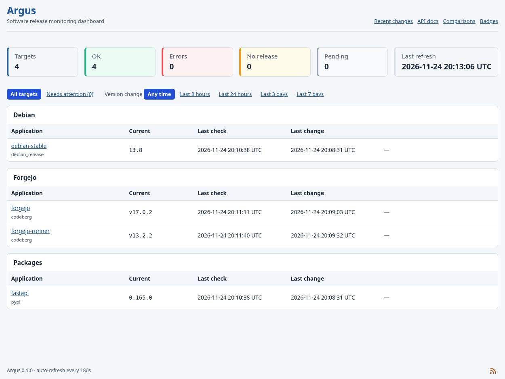
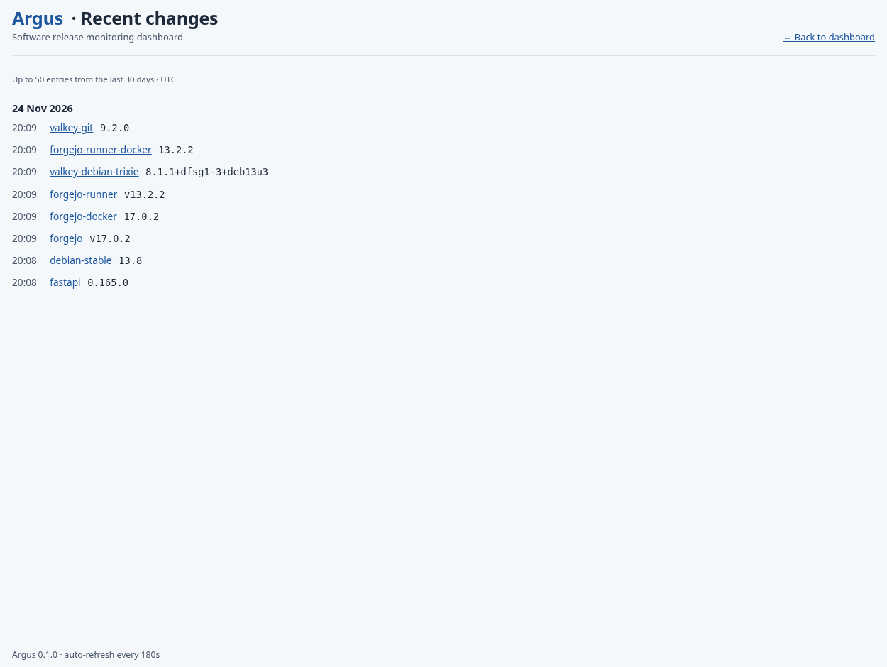
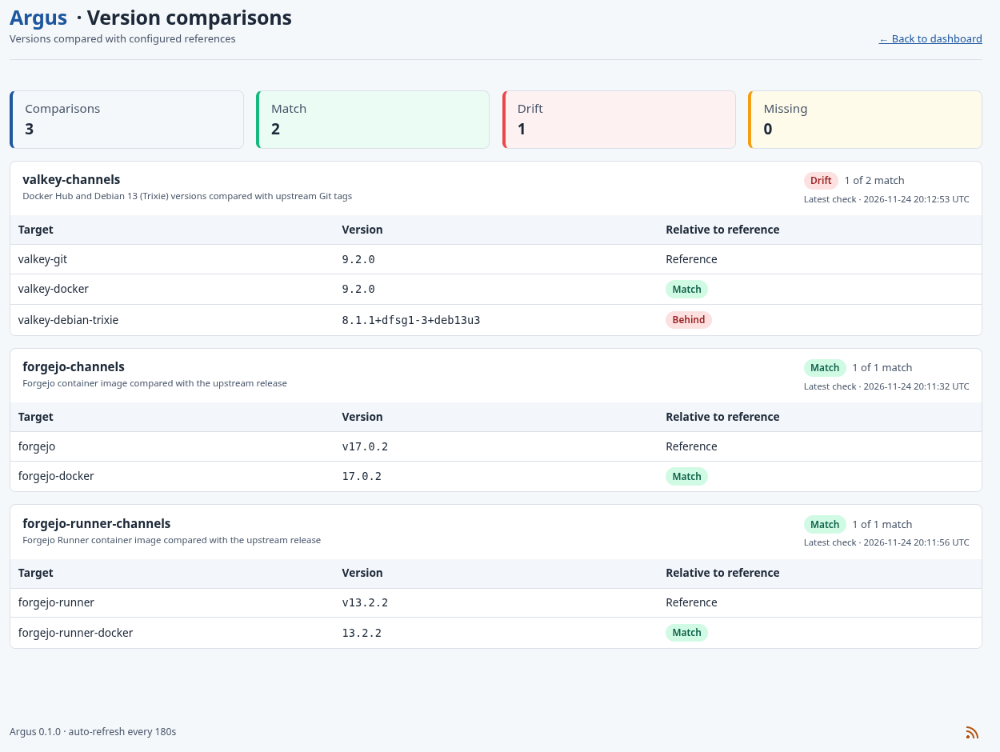
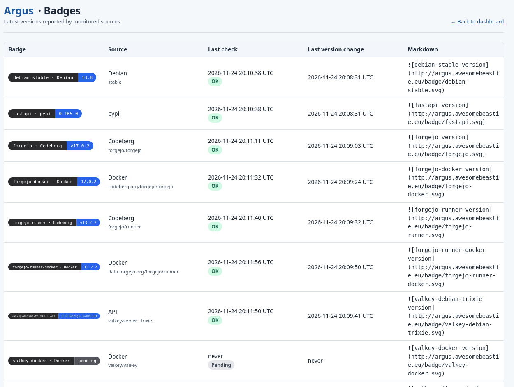
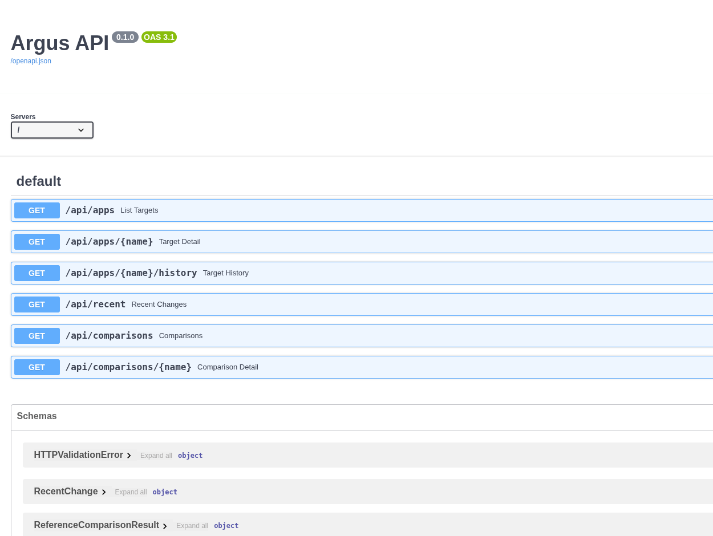

# pi-pip!

pi-pip! watches for new versions of the software you use. It checks container registries, repositories and package indexes on a schedule, shows the versions it finds on a dashboard, keeps a history in SQLite, and can send notifications through ntfy.

Development of pi-pip! was assisted by AI coding tools.



<details>
<summary>More screenshots</summary>









</details>

## Quick start

```sh
mkdir -p data
docker compose up -d --build
```

Open <http://localhost:8080>. pi-pip! reads `config.yaml` and stores its database in `data/`. The container runs as UID 1000 and needs write access to that directory. To use a different host port, run `PIPIP_HTTP_PORT=9090 docker compose up -d` and open <http://localhost:9090>.

You can also run pi-pip! directly with `uv run python -m pipip` and Python 3.12 or newer. Set `PIPIP_CONFIG` to load another YAML file.

### Upgrading from Argus

Stop the existing Argus instance before starting pi-pip! with the same `data/`
directory. After a clean shutdown, rename `data/argus.db` to `data/pipip.db` to
carry over your history and notification queue. If SQLite left a `-wal`, `-shm`,
or `-journal` file alongside the database, rename it with the same basename
change before starting pi-pip!. Update any explicit `database.url` or
`PIPIP_DATABASE_URL` that points to the renamed file. Update deployment settings
that use `ARGUS_*` variables to use `PIPIP_*`, and change references to the Compose
service from `argus` to `pipip`. Update Prometheus queries to use the `pipip_`
metric prefix.

### Remote access

The Compose port listens on loopback. For remote access, put NGINX or HAProxy in front of pi-pip! and let the proxy handle HTTPS and authentication. pi-pip! has no login of its own.

A proxy on the Docker host can forward to `http://127.0.0.1:8080`. If the proxy runs in Docker, connect both services to a shared private network, forward to `http://pipip:8080`, and remove the host port mapping. [NGINX Basic Auth](https://nginx.org/en/docs/http/ngx_http_auth_basic_module.html) · [HAProxy Basic Auth](https://www.haproxy.com/documentation/haproxy-configuration-tutorials/security/authentication/basic-authentication/)

To serve pi-pip! under a path such as `/pipip/`, set `http.root_path: /pipip` in
`config.yaml`. If you use a reverse proxy, forward the full request path, including
`/pipip/`. Docker can still check the app at `/health`.

## Add something to watch

Edit [config.yaml](config.yaml). Each entry under `targets` names a source and tells pi-pip! what to look for. For example, this tracks versioned Valkey images on Docker Hub.

```yaml
targets:
  - name: valkey-docker
    source: docker
    options:
      image: valkey/valkey
      version_regex: '^[0-9]+\.[0-9]+\.[0-9]+$'
```

pi-pip! also supports Zot, GitHub, Codeberg, Git tags, APT repositories, Debian releases, PyPI, and npm. Checks run every six hours by default. Use `interval_seconds` to change a target’s schedule and `group` to put related targets together on the dashboard.

Set `enabled: false` to pause a target and keep its history. Removing a target from YAML deletes its version and digest history at the next startup.

After editing `config.yaml`, run `docker compose restart pipip`. After changing Compose settings or environment variables passed to the container, run `docker compose up -d`.

### Git tags and SSH

For `git_tag` targets, `options.url` is the Git remote. It accepts HTTPS, `ssh://`, and
`git://` URLs. SSH requires the runtime user to have access to the repository and to
trust the server's host key. Use `options.web_url` for a separate browser link. Put
`{tag}` where the URL should include the detected tag.

```yaml
targets:
  - name: project-git
    source: git_tag
    options:
      url: ssh://git@git.example.org:2222/team/project.git
      web_url: "https://code.example.org/team/project/-/tags/{tag}"
```

The dashboard shows a tag link when `web_url` contains `{tag}`. An existing target's
link updates on its next check.

For SSH in Docker, add these mounts under the `pipip` service's existing `volumes`.
Use a verified `known_hosts` entry for the Git server. For a non-default SSH port,
the host entry uses `[hostname]:port`.

```yaml
- ./ssh/known_hosts:/home/pipip/.ssh/known_hosts:ro
- ./ssh/id_ed25519:/home/pipip/.ssh/id_ed25519:ro
```

Mount the key if the repository requires key authentication. Use a dedicated
read-only deploy key for unattended access. On the host, set the private key file's
mode to `600` and make it readable by the container's runtime UID (1000 by default).

### Notifications

Enable ntfy under `notifiers.ntfy`. Targets can list `notifiers: [ntfy]` or inherit the enabled channel. pi-pip! retries failed deliveries.

Use `${VAR}` or `${VAR:-default}` in `config.yaml` to read a value from the environment. To enable ntfy through Compose, set `NTFY_ENABLED=true`, `NTFY_SERVER` to your server URL, and `NTFY_TOPIC` to your topic. pi-pip! requires both destination values when ntfy is enabled.

For ntfy authentication, set `NTFY_TOKEN` or set both `NTFY_USER` and
`NTFY_PASSWORD`. When both methods are configured, pi-pip! uses the token.

pi-pip! tries to deliver notifications after each target check. The scheduler also
processes the queue about 10 seconds after startup and then every 60 seconds by
default. Change `scheduler.notification_dispatch_seconds` to adjust that interval.
Failed deliveries wait for their retry delay before they become eligible again.

#### Inspect and test the notification queue

Run the [queue script](scripts/notification_queue.py) from the repository root. It
uses the SQLite database from your pi-pip! configuration. To select another existing
database, pass `--db PATH` before the subcommand.

```sh
uv run python -m scripts.notification_queue list
uv run python -m scripts.notification_queue list --status failed
uv run python -m scripts.notification_queue --db data/pipip.db list
```

To test what an update looks like in ntfy, queue a message with the same title and
version format as a real update.

```sh
uv run python -m scripts.notification_queue add --notifier ntfy \
  --target fastapi --title "fastapi: new version detected" \
  --message "0.165.0 → 0.165.1"

uv run python -m scripts.notification_queue add --notifier ntfy \
  --target forgejo --title "forgejo: new version detected" \
  --message "v17.0.2 → v17.0.3"
```

The running pi-pip! instance delivers queued messages through the selected channel
when it is enabled. These examples leave target version history untouched.

```sh
uv run python -m scripts.notification_queue clear --status sent
```

Omitting `--status` from `clear` deletes every queue entry, including pending ones.

## Dashboard, feeds and badges

| Open | What you’ll see |
| --- | --- |
| `/` | Current versions, check results, and links to each target’s history |
| `/recent` | Recent changes grouped by date in UTC, with the previous version when available |
| `/comparisons` | How the selected targets compare with a reference version |
| `/feed.atom` | Recent releases, optionally filtered with `?group=<name>` |
| `/comparisons.atom` | Current comparison results in an Atom feed |
| `/badges` | A catalog of SVG badges you can embed elsewhere |

The dashboard sorts groups alphabetically and puts ungrouped targets at the end. Within each group, targets are sorted by name.

The example configuration compares Valkey on Docker Hub and Debian 13 (Trixie) with upstream Git tags. The comparisons page follows the order in `config.yaml`. To add a comparison, choose a `reference` target and list the `targets` to compare with it. The page and feed use the latest stored versions from regular target checks. Notifications are sent for changes to individual targets.

The example configuration enables Atom, badges, and the API. Set `badges.targets`
to a list of target names to publish badges for just those targets.

```yaml
badges:
  enabled: true
  targets: [fastapi, forgejo]
```

Use `targets: all` to publish badges for every target. The release feed accepts
the same selection under `atom.targets`. Copy the SVG URL from `/badges` to embed
a badge elsewhere.

## History and storage

- `history.retention` sets how many versions pi-pip! keeps and shows **per target**.
- `recent.days` sets how far back **Recent changes** looks.
- `recent.limit` caps the total entries on **Recent changes**, across all targets.

The SQLite file is `./data/pipip.db` locally and `/data/pipip.db` inside Docker. Set `database.url: "sqlite:///:memory:"` to keep the history and notification queue in memory until pi-pip! exits.

## API and Prometheus

Open [Swagger UI](http://localhost:8080/docs) and use **Try it out** to query targets, version history, or comparisons. Swagger assets load from jsDelivr. The API is read-only and its schema is at `/openapi.json`.

- `GET /api/apps` lists targets.
- `GET /api/apps/{name}` shows one target.
- `GET /api/apps/{name}/history?limit=10` shows up to ten versions for that target.
- `GET /api/recent` lists recent version detections using the same window and limit as `/recent`.
- `GET /api/comparisons` lists comparisons.
- `GET /api/comparisons/{name}` shows one comparison.

Prometheus metrics are disabled by default. To expose `/metrics`, set
`metrics.enabled` to `true`.

Scrape `/metrics` to see whether each target is enabled, whether its last check succeeded, and when it was last checked or changed versions. A zero timestamp means no event has been recorded. Docker uses `/health` to check that SQLite is reachable.

`pipip_http_requests_total` and `pipip_http_retries_total` count outbound HTTP requests and retry attempts by host since pi-pip! started. To see retries in the last 15 minutes, use `increase(pipip_http_retries_total[15m])`.

## Logs

pi-pip! writes text logs by default. To use JSON locally, run
`PIPIP_LOG_FORMAT=json uv run python -m pipip`. In Docker, add
`PIPIP_LOG_FORMAT: json` to the `pipip` service’s `environment` in
[compose.yaml](compose.yaml), then run `docker compose up -d`.

View the output with `docker compose logs -f pipip`. Uvicorn uses its own
log format for server and HTTP access logs.

## Development

To add a source, implement `SourceProvider` in [pipip/sources](pipip/sources). For a notification channel, implement `Notifier` in [pipip/notifiers](pipip/notifiers).

```sh
uv run --extra dev ruff check .
uv run --extra dev mypy pipip
uv run --extra dev python -m pytest -q --cov=pipip --cov-report=term-missing --cov-fail-under=80
uv run --extra dev pip-audit -r requirements.lock
```

Local check results on 2026-11-24

```text
All checks passed!
Success: no issues found in 42 source files
Required test coverage of 80% reached. Total coverage: 91.78%
146 passed in 3.69s
No known vulnerabilities found
```

### Update dependency locks

From the repository root, refresh `uv.lock`, export the runtime lock for Docker
and the development lock for pip-based installs, then refresh Docker's build dependencies.

```sh
uv lock --upgrade
uv export --locked --no-dev --no-emit-project -o requirements.lock
uv export --locked --extra dev --no-emit-project -o requirements-dev.lock
uv pip compile requirements-build.in --upgrade --generate-hashes -o requirements-build.lock
```

Review and commit the lockfile changes together.
